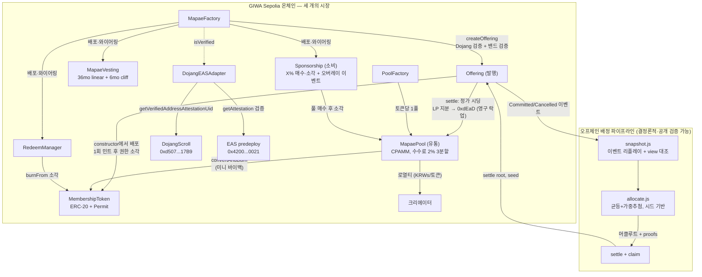

# GIWA Sepolia 배포

체인: GIWA Sepolia (chain ID `91342`) · Explorer: https://sepolia-explorer.giwa.io

## v3.2 배포 (공식 도장 인식, 둘 다 인정, Dev 첫 매수 5% 상한), 2026-11-16 완료

- 규칙: 실명 판정은 `DojangAnyOf`. GIWA 공식 도장(TESTNET_FAUCET 발행자, `DojangEASAdapter`)과 MockDojang 중 하나라도 true면 실명이다
  (결정 46). 발행 tx 안의 Dev 첫 매수는 받는 토큰이 5,000만 개(총공급의 5%)를 넘으면 `DevFirstBuyTooLarge`로 발행 전체가 되돌아간다
  (결정 49). CurveSale, MapaePool, MembershipToken 코드는 v3.1과 같다. 자세한 내용은 [`docs/WORKLOG_v3.md`](WORKLOG_v3.md)의 v3.2 절.
- 배포 절차: [`docs/DEPLOY_V3_2.md`](DEPLOY_V3_2.md). 주소 기록: [`deployments/giwa-sepolia-v3_2.json`](../deployments/giwa-sepolia-v3_2.json)
- 배포 블록 `41419458` · 배포자 테스트 지갑 A [`0x45D52d167d22970f69dCd127dFc38D875A29EFb0`](https://sepolia-explorer.giwa.io/address/0x45D52d167d22970f69dCd127dFc38D875A29EFb0) · CurveFactory owner는 배포 뒤
  [`0x67a29AE83f3320C5E9b81D8a1531dE8FcCBED00C`](https://sepolia-explorer.giwa.io/address/0x67a29AE83f3320C5E9b81D8a1531dE8FcCBED00C)로 이전 ([`0x12041a1f…`](https://sepolia-explorer.giwa.io/tx/0x12041a1fbea794d21484119536f776fd43d5f97fd37e270a6f1e2e79c9081e5c))
- 우선 구간 `priorityWindow` 600초, 테스트넷 WETH 가상 호가 준비금 0.002 ETH(재사용 MapaeFactory에 등록된 값 그대로)
- 새로 배포한 세 컨트랙트는 Blockscout에서 검증됐다. 재사용 6개(MockKRW, MockDojang, PoolFactory, FeeRouter, MapaeFactory(mock),
  MembershipTokenDeployer)는 v3.1 주소 그대로이고 v3.1 때 검증돼 있다.

| 컨트랙트 | 주소 | 비고 |
|---|---|---|
| DojangEASAdapter | [`0x6cADa83208B32c2Ee0D0dB0341cfD0BF7B1584a4`](https://sepolia-explorer.giwa.io/address/0x6cADa83208B32c2Ee0D0dB0341cfD0BF7B1584a4) | 신규. 발행자 ID TESTNET_FAUCET로 조회 · 배포 tx [`0x3b5dcebb…`](https://sepolia-explorer.giwa.io/tx/0x3b5dcebb94e022c3d4efbca2fab5f79ed8ac4693e331524c8cf18db27a9d86c9) |
| DojangAnyOf | [`0x87326FbbF76e724bA2bA954dAc04c3B939999f84`](https://sepolia-explorer.giwa.io/address/0x87326FbbF76e724bA2bA954dAc04c3B939999f84) | 신규. 어댑터 또는 MockDojang · 배포 tx [`0x66b43898…`](https://sepolia-explorer.giwa.io/tx/0x66b43898edfe0add57f2f94d73b936f29941a62cb4a1df6c5eea60112fd44431) |
| CurveFactory | [`0x9b8155C39cdB912557d8588157fC11e8D989e652`](https://sepolia-explorer.giwa.io/address/0x9b8155C39cdB912557d8588157fC11e8D989e652) | 신규. dojang = DojangAnyOf, 웹이 쓰는 팩토리 · 배포 tx [`0xa5eb7bc2…`](https://sepolia-explorer.giwa.io/tx/0xa5eb7bc204b915049a003fd30f0dc70140ae6057279031cccbae5b4aa5b5ab7a) |
| MockKRW | [`0x74eC9141afAd51F346BA5B841Ba93D573e8786fD`](https://sepolia-explorer.giwa.io/address/0x74eC9141afAd51F346BA5B841Ba93D573e8786fD) | v3.1 주소 재사용 |
| MockDojang | [`0xaf80C431813EC4d2Cb34B3EC5b064095256871f8`](https://sepolia-explorer.giwa.io/address/0xaf80C431813EC4d2Cb34B3EC5b064095256871f8) | v3.1 주소 재사용 (selfVerify 쓰기 대상) |
| PoolFactory | [`0xf4E7Bf1ACe429400AC23E271E4409D212677e44F`](https://sepolia-explorer.giwa.io/address/0xf4E7Bf1ACe429400AC23E271E4409D212677e44F) | v3.1 주소 재사용 |
| FeeRouter | [`0xAB665B7867080cd62Aa316717400f3Cc094E7bd6`](https://sepolia-explorer.giwa.io/address/0xAB665B7867080cd62Aa316717400f3Cc094E7bd6) | v3.1 주소 재사용 |
| MapaeFactory (mock) | [`0xC0E22127A44266cCC56B2503504373777d0645A9`](https://sepolia-explorer.giwa.io/address/0xC0E22127A44266cCC56B2503504373777d0645A9) | v3.1 주소 재사용 (호가 자산 등록) |
| MembershipTokenDeployer (라이브러리) | [`0x9F011858B85b93a73330B56319Dc76a6f3255279`](https://sepolia-explorer.giwa.io/address/0x9F011858B85b93a73330B56319Dc76a6f3255279) | v3.1 주소 재사용 (`--libraries`로 링크) |

v3.1 CurveFactory(`0x06f0…205D`)와 그 토큰은 체인에 그대로 남지만 웹 목록에는 나오지 않는다(v3에서 v3.1로 갈 때와 같은 처리).

## v3.1 배포 (실명 우선 구간, 풀 스왑 개방), 2026-11-15 완료

- 규칙: 커브 개설 후 `priorityWindow`(기본 10분) 동안만 실명 지갑이 매수, 그 뒤 누구나 매수. 매도와 졸업 풀 스왑은 누구나.
  커브 개설과 L1 공모 응모는 실명 유지. 자세한 내용은 [`docs/WORKLOG_v3.md`](WORKLOG_v3.md)의 v3.1 절.
- 배포 절차: [`docs/DEPLOY_V3_1.md`](DEPLOY_V3_1.md). 주소 기록: [`deployments/giwa-sepolia-v3_1.json`](../deployments/giwa-sepolia-v3_1.json)
- 배포 블록 `41377077` (첫 배포 트랜잭션 블록) · 배포자 [`0x67a29AE83f3320C5E9b81D8a1531dE8FcCBED00C`](https://sepolia-explorer.giwa.io/address/0x67a29AE83f3320C5E9b81D8a1531dE8FcCBED00C) · 트레저리 [`0x3ada0Cb1fbb700AC4B41f5D7A9dbE2BC47b9FAaa`](https://sepolia-explorer.giwa.io/address/0x3ada0Cb1fbb700AC4B41f5D7A9dbE2BC47b9FAaa)
- 우선 구간 `priorityWindow` 600초

| 컨트랙트 | 주소 | 비고 |
|---|---|---|
| MockKRW | [`0x74eC9141afAd51F346BA5B841Ba93D573e8786fD`](https://sepolia-explorer.giwa.io/address/0x74eC9141afAd51F346BA5B841Ba93D573e8786fD) | v3 주소 재사용 |
| MockDojang | [`0xaf80C431813EC4d2Cb34B3EC5b064095256871f8`](https://sepolia-explorer.giwa.io/address/0xaf80C431813EC4d2Cb34B3EC5b064095256871f8) | v3 주소 재사용 |
| PoolFactory | [`0xf4E7Bf1ACe429400AC23E271E4409D212677e44F`](https://sepolia-explorer.giwa.io/address/0xf4E7Bf1ACe429400AC23E271E4409D212677e44F) | 신규 (MapaePool 바이트코드 변경) |
| FeeRouter | [`0xAB665B7867080cd62Aa316717400f3Cc094E7bd6`](https://sepolia-explorer.giwa.io/address/0xAB665B7867080cd62Aa316717400f3Cc094E7bd6) | 신규 |
| BuybackVault / BuybackExecutor | [`0x3Ed11f7Bcc36B3603d51736652884800daa2f54c`](https://sepolia-explorer.giwa.io/address/0x3Ed11f7Bcc36B3603d51736652884800daa2f54c) / [`0x195329375AfbE450DB73A7a2616084C999765f05`](https://sepolia-explorer.giwa.io/address/0x195329375AfbE450DB73A7a2616084C999765f05) | 신규 |
| DojangEASAdapter | [`0x8Cad1060c003270F1680BFb82b2F6068bc48b640`](https://sepolia-explorer.giwa.io/address/0x8Cad1060c003270F1680BFb82b2F6068bc48b640) | 신규 |
| MapaeFactory (mock / EAS) | [`0xC0E22127A44266cCC56B2503504373777d0645A9`](https://sepolia-explorer.giwa.io/address/0xC0E22127A44266cCC56B2503504373777d0645A9) / [`0xbDE1429fA07621251BE87248cD61c4f5f554693C`](https://sepolia-explorer.giwa.io/address/0xbDE1429fA07621251BE87248cD61c4f5f554693C) | 신규 (PoolFactory 참조, Offering 코드 변경) |
| CurveFactory (mock / EAS) | [`0x06f042817c7bBb18C793c586E7afe2870205355D`](https://sepolia-explorer.giwa.io/address/0x06f042817c7bBb18C793c586E7afe2870205355D) / [`0x1Ac4017A568Ec42dF8477a997c09720C975b096f`](https://sepolia-explorer.giwa.io/address/0x1Ac4017A568Ec42dF8477a997c09720C975b096f) | 신규 (CurveSale 코드 변경). 웹은 mock 쪽을 쓴다 |
| MembershipTokenDeployer (라이브러리) | [`0x9F011858B85b93a73330B56319Dc76a6f3255279`](https://sepolia-explorer.giwa.io/address/0x9F011858B85b93a73330B56319Dc76a6f3255279) | forge가 broadcast 중 배포 |

## v3 배포 (실명 본딩커브 런치패드), 2026-11-14 완료

- 배포 블록 `41311959` · 배포자 [`0x67a29AE83f3320C5E9b81D8a1531dE8FcCBED00C`](https://sepolia-explorer.giwa.io/address/0x67a29AE83f3320C5E9b81D8a1531dE8FcCBED00C)
- 트레저리 (FeeRouter `platformTreasury`, MapaeFactory `feeRecipients.platform`): [`0x3ada0Cb1fbb700AC4B41f5D7A9dbE2BC47b9FAaa`](https://sepolia-explorer.giwa.io/address/0x3ada0Cb1fbb700AC4B41f5D7A9dbE2BC47b9FAaa)
- 주소 기록: [`deployments/giwa-sepolia-v3.json`](../deployments/giwa-sepolia-v3.json), 데모 결과: [`deployments/demo-curve-state.json`](../deployments/demo-curve-state.json)
- Blockscout verified **22개**: 아래 컨트랙트 16개 + 커브 데모 자식 6개(CurveSale 2, 토큰 2, 졸업 풀 2)

### 컨트랙트

| 컨트랙트 | 주소 |
|---|---|
| MockKRW (KRWs) | [`0x74eC9141afAd51F346BA5B841Ba93D573e8786fD`](https://sepolia-explorer.giwa.io/address/0x74eC9141afAd51F346BA5B841Ba93D573e8786fD) |
| MockDojang | [`0xaf80C431813EC4d2Cb34B3EC5b064095256871f8`](https://sepolia-explorer.giwa.io/address/0xaf80C431813EC4d2Cb34B3EC5b064095256871f8) |
| PoolFactory | [`0xf123d8308DE27D0E91B85E0c4A81843Ebff5Ba2f`](https://sepolia-explorer.giwa.io/address/0xf123d8308DE27D0E91B85E0c4A81843Ebff5Ba2f) |
| FeeRouter | [`0xfC7a9B07a1AA814225db64F7Bb90777Ff7127e86`](https://sepolia-explorer.giwa.io/address/0xfC7a9B07a1AA814225db64F7Bb90777Ff7127e86) |
| BuybackVault | [`0xc1Db7149c74294B467764F83062A79CB0b2378Ad`](https://sepolia-explorer.giwa.io/address/0xc1Db7149c74294B467764F83062A79CB0b2378Ad) |
| BuybackExecutor | [`0x1e77b059f4B612f1D3b9B770A0E51F53879Ae718`](https://sepolia-explorer.giwa.io/address/0x1e77b059f4B612f1D3b9B770A0E51F53879Ae718) |
| DojangEASAdapter | [`0xEFC619C99f7C3325437223bC599296FE52Ef0971`](https://sepolia-explorer.giwa.io/address/0xEFC619C99f7C3325437223bC599296FE52Ef0971) |
| MapaeFactory (mock) | [`0x67229C8bb4d6847D516A5D0B0ed2c6E07FB0535f`](https://sepolia-explorer.giwa.io/address/0x67229C8bb4d6847D516A5D0B0ed2c6E07FB0535f) |
| └ OfferingDeployer (mock) | [`0x3f1B77a601fBDe68415C7786e4457ed518e6a531`](https://sepolia-explorer.giwa.io/address/0x3f1B77a601fBDe68415C7786e4457ed518e6a531) |
| └ StackDeployer (mock) | [`0xdcAFff7e6a5df59f6E7fF71294234954827c81b0`](https://sepolia-explorer.giwa.io/address/0xdcAFff7e6a5df59f6E7fF71294234954827c81b0) |
| MapaeFactory (EAS) | [`0x025BCc44F70dF0E65391DB3D6774028A4DE36447`](https://sepolia-explorer.giwa.io/address/0x025BCc44F70dF0E65391DB3D6774028A4DE36447) |
| └ OfferingDeployer (EAS) | [`0x1E7CEeA1158E4e2C4b72aa2dD0A75a28a2eD10be`](https://sepolia-explorer.giwa.io/address/0x1E7CEeA1158E4e2C4b72aa2dD0A75a28a2eD10be) |
| └ StackDeployer (EAS) | [`0x663D11DA88B7dE12c14e0080946149846C82001a`](https://sepolia-explorer.giwa.io/address/0x663D11DA88B7dE12c14e0080946149846C82001a) |
| CurveFactory (mock) | [`0x0802B645018bF2Af9C2C940f8cBB437511178f59`](https://sepolia-explorer.giwa.io/address/0x0802B645018bF2Af9C2C940f8cBB437511178f59) |
| CurveFactory (EAS) | [`0x6c29384B98806e1f9630Af45C0b883532b930F6F`](https://sepolia-explorer.giwa.io/address/0x6c29384B98806e1f9630Af45C0b883532b930F6F) |
| MembershipTokenDeployer (링크 라이브러리) | [`0x9F011858B85b93a73330B56319Dc76a6f3255279`](https://sepolia-explorer.giwa.io/address/0x9F011858B85b93a73330B56319Dc76a6f3255279) |
| WETH (predeploy, 배포 대상 아님) | [`0x4200000000000000000000000000000000000006`](https://sepolia-explorer.giwa.io/address/0x4200000000000000000000000000000000000006) |

### 호가 자산 등록 (두 MapaeFactory 공통)

| 호가 자산 | 커브 가상 호가 준비금 | 비고 |
|---|---|---|
| MockKRW (KRWs) | 2,000,000 KRWs | 메인넷 프리셋과 같은 값 |
| WETH | 0.002 ETH | 테스트넷 값 (메인넷 프리셋은 0.6 ETH) |

### 커브 데모 (mock 스택)

| 항목 | 데모 A: KRWs 커브 (DCK) | 데모 B: ETH 커브 (DCE) |
|---|---|---|
| CurveSale | [`0x66a31a0B0762f6a1426b968733703f38a918BB56`](https://sepolia-explorer.giwa.io/address/0x66a31a0B0762f6a1426b968733703f38a918BB56) | [`0x83207273A5f99820f734Fc18Fd7D1562C478A8E8`](https://sepolia-explorer.giwa.io/address/0x83207273A5f99820f734Fc18Fd7D1562C478A8E8) |
| 토큰 | [`0xF96729b2FEda89eE338Ea8FE6484c4BEb4a999EB`](https://sepolia-explorer.giwa.io/address/0xF96729b2FEda89eE338Ea8FE6484c4BEb4a999EB) | [`0x0E2006E80E45d501686499be51552F08EeA25081`](https://sepolia-explorer.giwa.io/address/0x0E2006E80E45d501686499be51552F08EeA25081) |
| 졸업 풀 | [`0x324dA7BB31152fC25C35D200a1C84037B1291F4f`](https://sepolia-explorer.giwa.io/address/0x324dA7BB31152fC25C35D200a1C84037B1291F4f) | [`0x91a5C62aBB9d81360B916EC605ED0123C3E3f1b0`](https://sepolia-explorer.giwa.io/address/0x91a5C62aBB9d81360B916EC605ED0123C3E3f1b0) |
| 매수 방식 | 실명 매수자 12명 | 단일 지갑 셀프 졸업 |
| 졸업 준비금 | 6,000,000 KRWs | 0.006 ETH |
| 졸업 블록 | `41312432` | `41312454` |
| 졸업 tx | [`0xce2e395e…`](https://sepolia-explorer.giwa.io/tx/0xce2e395e9e840b284edbd15e5b198bfe9fafe73ea9ebceea148f0023a73a84fb) | [`0x6d2acfeb…`](https://sepolia-explorer.giwa.io/tx/0x6d2acfeb3121eb0d5839cdd33b0840beca34f27c1b8ceff4c95c4ff46aaa0338) |

두 졸업 풀 모두 `totalFeeBps() == 100`, 트레저리의 발행 토큰 잔고 0.

### 가스 실측

| 동작 | 가스 |
|---|---|
| `createCurve` | 3,644,355 |
| 첫 매수 (`buy`) | 147,151 |
| 졸업 매수 (`buy`) | 2,489,227 |
| `createCurveWithETH` | 3,408,842 |
| 졸업 매수 (`buyWithETH`) | 2,575,241 |

### 재현 명령

v3 당시 명령이다. 지금 `script/DeployV3.s.sol`은 v3.1 스택을 배포하므로, v3 그대로 재현하려면 태그 `v3.0-curve`의
스크립트를 쓴다. 배포 (트레저리는 배포자와 다른 주소여야 한다):

```bash
TREASURY_ADDRESS=0x... forge script script/DeployV3.s.sol --account deployer --rpc-url $GIWA_SEPOLIA_RPC_URL --broadcast --verify --verifier blockscout --verifier-url $BLOCKSCOUT_API_URL
```

팩토리 자식 verify (mock 스택, 라이브러리 주소는 `deployments/giwa-sepolia-v3.json` 에서 읽는다):

```bash
node script/verify-children.js --rpc $GIWA_SEPOLIA_RPC_URL --verifier-url $BLOCKSCOUT_API_URL --from-block 41311959 --factory 0x67229C8bb4d6847D516A5D0B0ed2c6E07FB0535f --curve-factory 0x0802B645018bF2Af9C2C940f8cBB437511178f59
```

커브 데모 (시나리오 A, B):

```bash
forge script script/DemoCurve.s.sol --account deployer --sender 0x67a29AE83f3320C5E9b81D8a1531dE8FcCBED00C --rpc-url $GIWA_SEPOLIA_RPC_URL --broadcast --slow
```

---

## 이전 배포 (v1.0, v2.0.1)

아래는 v3 이전 배포 기록 원문이다.

# GIWA Sepolia 배포 (GASOK 1기 제출)

체인: GIWA Sepolia (chain ID `91342`) · Explorer: https://sepolia-explorer.giwa.io

> **상태: 최종 배포 완료 — 2026-07-23 배포 · 2026-07-24 데모 완결 (UTC).**
> **제출 컨트랙트 13종(타입) · 배포 주소 전량 Blockscout verified ✅** (직접 배포 + 내부 CREATE — 디플로이어·풀 포함).
> **최종 검증: 2026-08-03 17:00 KST** (E 정산 후 `verify-children.js` `done: 8/8`, F 개설 후 `done: 7/7`). 롤링 데모 공모는 개설·정산 직후 `verify-children.js`로 검증한 뒤 아래 "롤링 데모 공모"에 추가하고 **이 줄을 갱신**한다.
> 배포자: `0x67a29AE83f3320C5E9b81D8a1531dE8FcCBED00C` · 심사위원 워크스루: [`docs/SUBMISSION.md`](SUBMISSION.md)

## v5.2 (Milestone A · `v2.0.1-core`) 배포 — 완료 ✅

체인 91342 · 배포자 `0x67a29AE83f3320C5E9b81D8a1531dE8FcCBED00C` · 배포 블록 `34476489` ·
상위 9개 + 팩토리 생성자가 배포한 Deployer 4개, 전부 Blockscout verified. 상위 9개는
`forge script --verify`로 Blockscout verify 완료. 온체인 배선 검증: FeeRouter L1 프리셋
`(750,40,60,30,20,400)`, treasury=deployer, factoryMock.minRaise=500,000e18,
isBurner(vault)=true. (주소 매핑은 배포 스크립트가 기록한 `deployments/giwa-sepolia.json` /
`== Logs ==` 기준 — 브로드캐스트 영수증의 contractName 라벨은 이번 런에서 뒤섞여 사용 안 함.)

### 신규/코어 컨트랙트

| 컨트랙트 | 주소 |
|---|---|
| MockKRW (KRWs) | [`0x8954a3a4738a10B9c4493e85aA24E95E2c85E400`](https://sepolia-explorer.giwa.io/address/0x8954a3a4738a10B9c4493e85aA24E95E2c85E400) |
| MockDojang | [`0xeB589Ec91b1a787e10fedaCfD69BA8b7304885ab`](https://sepolia-explorer.giwa.io/address/0xeB589Ec91b1a787e10fedaCfD69BA8b7304885ab) |
| PoolFactory | [`0x8Ea1d921EC72EA572eA27904dc836fc5AAB21805`](https://sepolia-explorer.giwa.io/address/0x8Ea1d921EC72EA572eA27904dc836fc5AAB21805) |
| **FeeRouter** (등급별 수수료 + 온체인 밴드) | [`0x2B264a6Ea5deAF8C584f461eD92a905DFB4C9696`](https://sepolia-explorer.giwa.io/address/0x2B264a6Ea5deAF8C584f461eD92a905DFB4C9696) |
| **BuybackVault** (withdraw 부재 = 소각 외 유출 불가) | [`0x200E2e763466902F78EEf9d9d4a7c61Fa4763A6C`](https://sepolia-explorer.giwa.io/address/0x200E2e763466902F78EEf9d9d4a7c61Fa4763A6C) |
| **BuybackExecutor** v1 | [`0x69dBEB61d7438D3C726796f621D8f137CBEBe147`](https://sepolia-explorer.giwa.io/address/0x69dBEB61d7438D3C726796f621D8f137CBEBe147) |
| **MapaeFactory (메인 데모, 등급제)** | [`0xd157b7be02E67Fbb0B098B4D982De0FB8ffFef7F`](https://sepolia-explorer.giwa.io/address/0xd157b7be02E67Fbb0B098B4D982De0FB8ffFef7F) |
| DojangEASAdapter | [`0x692C37F95dF80be611C2A64f6C7B7C9fb7E2fa7D`](https://sepolia-explorer.giwa.io/address/0x692C37F95dF80be611C2A64f6C7B7C9fb7E2fa7D) |
| MapaeFactory (GIWA-Native 쇼케이스) | [`0xe629D3B3a616D4cff6319F40F61AEfAe72531141`](https://sepolia-explorer.giwa.io/address/0xe629D3B3a616D4cff6319F40F61AEfAe72531141) |
| ├ OfferingDeployer (메인 데모 팩토리) | [`0xA04259D36A63Efdd3116e6990e9b1551a1a66c0C`](https://sepolia-explorer.giwa.io/address/0xA04259D36A63Efdd3116e6990e9b1551a1a66c0C) |
| ├ StackDeployer (메인 데모 팩토리) | [`0x7f3423F468c25204d8Cafa451971Ca67fF062b1f`](https://sepolia-explorer.giwa.io/address/0x7f3423F468c25204d8Cafa451971Ca67fF062b1f) |
| ├ OfferingDeployer (GIWA-Native 팩토리) | [`0x62A5b43a4E78ABe108EF3e78A213674F8828F395`](https://sepolia-explorer.giwa.io/address/0x62A5b43a4E78ABe108EF3e78A213674F8828F395) |
| └ StackDeployer (GIWA-Native 팩토리) | [`0x2f0A3150c17a97125fC2A258eA1864f829D3F653`](https://sepolia-explorer.giwa.io/address/0x2f0A3150c17a97125fC2A258eA1864f829D3F653) |

Deployer 4개는 각 팩토리 생성자가 배포한다(Blockscout creator = 팩토리, 팩토리의
`offeringDeployer()`/`stackDeployer()` getter로 대조).

### 배포 tx (Blockscout creation tx 기준 — 영수증 라벨 무시)

| 컨트랙트 | 배포 tx |
|---|---|
| MockKRW | [`0xadf8160a…d346`](https://sepolia-explorer.giwa.io/tx/0xadf8160a0b89f719797a1fb12181d5477d8a575db239d5c0bcf4cbf94090d346) |
| MockDojang | [`0x91c0dc19…d66d`](https://sepolia-explorer.giwa.io/tx/0x91c0dc192358d7d65746ad24061c20fbc1f4a18d9e6405e78d89b7527ff7d66d) |
| PoolFactory | [`0x0cbcfa3d…29f0`](https://sepolia-explorer.giwa.io/tx/0x0cbcfa3df27ee7323f3ea4a83accf035ea0bf32bbd7d1f921869aff0250829f0) |
| FeeRouter | [`0x2debec53…7cfa`](https://sepolia-explorer.giwa.io/tx/0x2debec53e3680897a5f3c5a19586bb3a656abf94be758e00ca2277eb36577cfa) |
| BuybackVault | [`0xde8d74ea…9bbe`](https://sepolia-explorer.giwa.io/tx/0xde8d74eab6567150ced3578e8773b4700d95f356bb568a0bc4e3f548d8c29bbe) |
| BuybackExecutor | [`0x5cce4fea…5933`](https://sepolia-explorer.giwa.io/tx/0x5cce4fead412659fc1f9636472f49a0f1ae55d26a3dd26e62fc41dfe19ee5933) |
| MapaeFactory(mock) + OfferingDeployer·StackDeployer | [`0x950b5f8f…fa2b`](https://sepolia-explorer.giwa.io/tx/0x950b5f8fb788598a6a88b5e550f325fa9ed6adb7b2e7d6bf22fb0d9b6390fa2b) |
| DojangEASAdapter | [`0xd1f03d16…baf2`](https://sepolia-explorer.giwa.io/tx/0xd1f03d168ef523dd4811a44d091aa0dc6a3decdb4b955fd686e498ce2f8ebaf2) |
| MapaeFactory(EAS) + OfferingDeployer·StackDeployer | [`0x77574899…0912`](https://sepolia-explorer.giwa.io/tx/0x77574899824672985e87569314ebaae0cfd58c051a0fe39a05a7642334420912) |
| (배선) `BuybackVault.setExecutor` | [`0xfb36d70c…fcf9`](https://sepolia-explorer.giwa.io/tx/0xfb36d70ca3fae7b672ec7e1def72fa456a3a8f2779f1145e256c31343934fcf9) |

> 2026-10-11 정정: 이전 표는 MockKRW↔MockDojang이 뒤바뀌고, BuybackExecutor 칸에 `setExecutor`
> 호출 tx가, MapaeFactory(mock)·DojangEASAdapter 칸에 한 칸씩 밀린 tx가 들어가 있었다(5행).

### 데모 스택 (등급제 4 시나리오)

`script/DemoStage1On.s.sol`(L0·L1 개설+응모) → deadline 경과 후
`script/DemoStage2aL0.s.sol`(≈1h: L0 settle·상장·클레임·스왑) /
`script/DemoStage2bL1.s.sol`(≈12h: L1 settle·클레임·리딤·유료 드랍·바이백).
데모 오퍼링 주소·tx 해시는 아래 (주소 원본: `deployments/demo-v2-state.json`).

<!-- DEMO-ADDRESSES -->

### v2.0.1 데모 — 온체인 실행 기록 (factoryMock)

테스트 지갑은 리포 공개 데모 니모닉(`DemoStage1On.s.sol`) idx0~3: creatorL1 [`0x63FE…c297`](https://sepolia-explorer.giwa.io/address/0x63FE8983be7Ce4b4C93caaBB19c3A4D22a78c297) ·
creatorL0 [`0x3EAe…03Fd`](https://sepolia-explorer.giwa.io/address/0x3EAe801088bF3eD75dF513367BF916eCcD8803Fd) · fanL1 [`0xFCB4…E67A`](https://sepolia-explorer.giwa.io/address/0xFCB455DA31Ae46cEd826563d7280E7add7A1E67A) ·
fanL0 [`0x6F22…8C5a`](https://sepolia-explorer.giwa.io/address/0x6F227f4754ad67A6C68451Aa3bF80bB4DE138C5a).

| 스택 | Offering | Token | Pool |
|---|---|---|---|
| L0 미니 (T≈1h) | [`0x4040…88ca`](https://sepolia-explorer.giwa.io/address/0x404041Df24F00419100aD1Dd045B6b32114788ca) | [`MAPL0`](https://sepolia-explorer.giwa.io/address/0x92004E6ef2Eb7De8e0540EA47cDF4AfFB299c68d) | [`0x04Cd…60b7`](https://sepolia-explorer.giwa.io/address/0x04Cd3c3594Fd6863D0bD52701261B01b9C2360b7) |
| L1 (T≈12h) | [`0x6093…8DAf`](https://sepolia-explorer.giwa.io/address/0x6093e2b21195D6A4F5031cF3173D034AE2688DAf) | [`MAPL1`](https://sepolia-explorer.giwa.io/address/0x7B6C3718d9Ae681ad974d61555bffC143429e8C3) | [`0xaD47…80d5`](https://sepolia-explorer.giwa.io/address/0xaD47c88e6200d8d27287A28297f95fc07ca580d5) |

**Stage 1 (2026-08-30, 블록 34757277~34757306)**: [`0xc8309833…`](https://sepolia-explorer.giwa.io/tx/0xc8309833d04793e02b0688f7e7c9f1d7dc56d8e4f8fcd2878d00620b0abe399c) setVerifiedBatch(4) ·
가스 송금 4건 · createOffering [`0x0c1f2757…`](https://sepolia-explorer.giwa.io/tx/0x0c1f275755115788d63478eb978248ccbff692f433dde2aae070d70f09661408) (L0) /
[`0x688f8dde…`](https://sepolia-explorer.giwa.io/tx/0x688f8dde1873bd3504c731bf8b5030def1a3f556b2b92917493de252e69ef44f) (L1) · commit L0 500k [`0x6ab35f0a…`](https://sepolia-explorer.giwa.io/tx/0x6ab35f0a3647dd86f33324ae8174a4ee6c6eda2ea9bdd4fe21dfa44071873207) ·
commit L1 1.5M [`0xb8de8997…`](https://sepolia-explorer.giwa.io/tx/0xb8de89976536188fa187d30de24a4118e4b246a78f5ecb4d52f84408369312e3)

#### L0 미니 (Stage 2a, 2026-08-30)

| 항목 | 기대값 | 실측 | tx |
|---|---|---|---|
| 상장 스팟가 | = P | 10,000e18 (krwSeed 124,999.99… / tokenSeed 12.499…) | [`0xb03d5346…`](https://sepolia-explorer.giwa.io/tx/0xb03d53461bdca4b578fed7f58ec0dac88fe3302fffe1bef5782ad1cdade2ec47) |
| LP 수령 주소 | 0xdEaD 100% | LP 1,249.99e18 전량 0xdEaD | 위 settle |
| 플랫폼 배분 경로 토큰 | 0 (L0 강제) | `recipients.platform` 민트 0 (Transfer wad=0) | 위 settle |
| reserve 몫 (커뮤니티 리저브) | 공급 7.5% | 5.357142857142857144e18 = 71.4285…e18 − 판매 50 − creator 5% − LP 17.5% (정확 일치) → `feeRecipients.reserve` = deployer | 위 settle |
| treasury KRWs | > 0, 분해 일치 | offeringFee 25,000 (500bps) + 스왑 platform 300 (60bps) / royalty 100 (20bps) / burn buffer 150 (30bps) | settle · [`0xae51a309…`](https://sepolia-explorer.giwa.io/tx/0xae51a3090cc5809961fd5d54128eb36eedbf3aaa0d94fb030972daf1f98414f6) |
| L0 cancel | revert `CancelDisabled()` | status 0, revert data `0x3a99ec16` (eth_call 동일) | [`0x8915ccfa…`](https://sepolia-explorer.giwa.io/tx/0x8915ccfaf9ee978f08c079ffff76b0e811d2c83d5106be51da19f9d56072ee1f) (2026-10-11) |

팩토리 자식 12개(두 스택의 Offering·MembershipToken·MapaePool·RedeemManager·MapaeVesting·
Sponsorship)는 2026-10-11 `node script/verify-children.js --factory 0xd157…Fef7F --from-block 34757177`
로 전량 verified(그 전까지 미검증 — `docs/TRUST.md` 이탈 기록 4). cancel 실패 tx는 Blockscout에서
`CancelDisabled()`로 디코딩된다.

seed `0x50`은 고정값(단일 leaf, 배정 결과 영향 없음 — `docs/TRUST.md` 이탈 기록).

#### L1 풀사이클 (Stage 2b, 2026-10-11)

| 항목 | 기대값 | 실측 | tx |
|---|---|---|---|
| L1 settle | 성공, seed = 지연 블록해시 | seed = **블록 38350312 해시** `0x91db…bddb`, settle 포함 블록 38350471. 판매 150 / 미판매 350 소각 / 유효 공급 250 | [`0x443a4b77…`](https://sepolia-explorer.giwa.io/tx/0x443a4b775b981713b51a452ce9b0fd08cb9f4d870380a0c5f1f4a4268f0c6519) |
| 상장 스팟가 | = P | 10,000e18 (krwSeed 225,000 / tokenSeed 22.5) | 위 settle |
| LP 수령 주소 | 0xdEaD 100% | LP 2,250e18 전량 0xdEaD | 위 settle |
| treasury KRWs | > 0, 분해 일치 | offeringFee 112,500 (750bps) · creator 1,162,500 · 풀 시딩 225,000 (합 1.5M) | 위 settle |
| claim | 150e18 | fanL1 150e18 | [`0x7b258e69…`](https://sepolia-explorer.giwa.io/tx/0x7b258e69c359236904cc46dc69dd4e919c710c6a375f5d10d7fd099bb497cb33) |
| 스왑 (대조군) | 수수료 이벤트 존재 | 20k → 1.8114e18, `PlatformFeePaid` 80 (40bps) · royalty 120 (60bps) · `BurnBufferAccrued` 60 (30bps), 스팟 10,000 → 11,829.70 | [`0xb872d62c…`](https://sepolia-explorer.giwa.io/tx/0xb872d62cda5c51cd05c14656f5b67a5e65120a68d26e287dc17f375050ed4194) |
| swapForBurn (후원 경로) | 수수료 이벤트 부재 | 후원 10k: creator 9,000 / 1,000 → `BurnSwapped` 0.08419e18 소각, `PlatformFeePaid`·royalty·burn buffer 없음 | [`0x514abfa2…`](https://sepolia-explorer.giwa.io/tx/0x514abfa25280ea6c8e2dd00a55ab1f0af8431f816b89102da7dfc96f3c5be4db) |
| 리딤 | 토큰 소각 | 5e18 소각 | [`0x8dd6546d…`](https://sepolia-explorer.giwa.io/tx/0x8dd6546d73ac0a7b72c11751993b4c5b88bdfa724dc4d289d3616787abefdd97) |
| 유료 드랍 merchFee | FeeRouter 경로로 수취 | 100,000 → merchFee 4,000 (400bps) → `feeRouter.platformTreasury()` · reroute 19,200 → BuybackVault (`Routed`) · creator 76,800 | [`0xc3dc70e3…`](https://sepolia-explorer.giwa.io/tx/0xc3dc70e3753b67a2567535db73d4e3c866abc84397d9035b97719db56246bcec) |
| 바이백 실행 | 소각만, 수수료 0 | 볼트 2,457.4 KRWs (dailyCap 1%) → `BurnSwapped` 0.204004e18 소각, 수수료 이벤트 없음 | [`0x54e3a411…`](https://sepolia-explorer.giwa.io/tx/0x54e3a41102e43d9dd0452e7172662974351d25520d4930a60945c74068da6e61) |

L1 사이클 종료 상태: 스팟 12,166.30 · 총공급 244.7118e18 (= 250 − 0.0842 − 5 − 0.2040) ·
볼트 잔여 16,742.6 KRWs · `vault.totalBurned(MAPL1)` 0.2040e18.
설정 tx: createRedeemable [`0x97f73fca…`](https://sepolia-explorer.giwa.io/tx/0x97f73fca776ddbd358a4903f1903930df85d27a6221b3664eb590461171e18c4) ·
createPaidDrop [`0x91611500…`](https://sepolia-explorer.giwa.io/tx/0x91611500add1d47b4688ab245351f8d5d1ac33a7a3423cbb6c29fdac94392da9) ·
setRerouteRate(2000) [`0x52597991…`](https://sepolia-explorer.giwa.io/tx/0x5259799194161a381c22242dfdc5fa125bf2db24fc7c1b082863ffd07a9693e0) ·
executor.setParams [`0xbe0baf05…`](https://sepolia-explorer.giwa.io/tx/0xbe0baf0599bc2ffbfcf5b683192ade653abc7224d2ea3ea8b2b6140c7b01fa08).


아래는 **M5(v1.0-gasok) 시점의 배포 기록**(역사 보존, GASOK 제출 증빙)이다.

## 제출 컨트랙트 (v1.0-gasok · 불변 · 전량 verified ✅)

### 코어

| 컨트랙트 | 주소 |
|---|---|
| MockKRW (KRWs) | [`0x44FAb686723C7672CF7cA9018baf502AFfE55d04`](https://sepolia-explorer.giwa.io/address/0x44FAb686723C7672CF7cA9018baf502AFfE55d04) |
| MockDojang (selfVerify 원클릭 체험) | [`0x850Eb31fd5418e902B8DB1e7f126b12032F787aB`](https://sepolia-explorer.giwa.io/address/0x850Eb31fd5418e902B8DB1e7f126b12032F787aB) |
| PoolFactory | [`0x392C0Dbb43d3f118D10f80F7FE33E5aeba41F7f6`](https://sepolia-explorer.giwa.io/address/0x392C0Dbb43d3f118D10f80F7FE33E5aeba41F7f6) |
| **MapaeFactory (메인 데모)** | [`0xb5b8f10fE64A785279329e1Ab1fE4AE67F3975A7`](https://sepolia-explorer.giwa.io/address/0xb5b8f10fE64A785279329e1Ab1fE4AE67F3975A7) |
| **DojangEASAdapter (실 Dojang 연동)** | [`0x69903dD3b32B5EC3BB8DE8D167053ec80e4b3566`](https://sepolia-explorer.giwa.io/address/0x69903dD3b32B5EC3BB8DE8D167053ec80e4b3566) |
| MapaeFactory (GIWA-Native 쇼케이스) | [`0xC4d23C7349FA1496f39380A32Cce98D850dB60dA`](https://sepolia-explorer.giwa.io/address/0xC4d23C7349FA1496f39380A32Cce98D850dB60dA) |

### Offering A 스택 (모드 A — 초과 응모·추첨·상장·리딤·후원)

| 컨트랙트 | 주소 |
|---|---|
| Offering A | [`0xdE5c071C58553A9fd8662eDdD51A30bAFCfabaec`](https://sepolia-explorer.giwa.io/address/0xdE5c071C58553A9fd8662eDdD51A30bAFCfabaec) |
| MembershipToken A (MAPA) | [`0xF18409dE4939996c996E9Ae454bE55cCfcc617F5`](https://sepolia-explorer.giwa.io/address/0xF18409dE4939996c996E9Ae454bE55cCfcc617F5) |
| **MapaePool A (정가 상장, LP→0xdEaD)** | [`0x23CAB150FA6Ca1503aA1FA10B1C7FE3b88db7CB6`](https://sepolia-explorer.giwa.io/address/0x23CAB150FA6Ca1503aA1FA10B1C7FE3b88db7CB6) |
| RedeemManager A | [`0x49B5006115eA7864281c9Cc8fEa829292A204Bb4`](https://sepolia-explorer.giwa.io/address/0x49B5006115eA7864281c9Cc8fEa829292A204Bb4) |
| MapaeVesting A (36mo/6mo) | [`0x4E0528b1C72073d55583332915f75A7cf2F7422f`](https://sepolia-explorer.giwa.io/address/0x4E0528b1C72073d55583332915f75A7cf2F7422f) |
| Sponsorship A | [`0x23b23Af6170E37D205F4D7C1d5f1E09cBE92226F`](https://sepolia-explorer.giwa.io/address/0x23b23Af6170E37D205F4D7C1d5f1E09cBE92226F) |

### Offering B 스택 (모드 B — 미달·미판매분 소각)

| 컨트랙트 | 주소 |
|---|---|
| Offering B | [`0x1e5050B8f6e6A5203dab37902b051B421D76b32c`](https://sepolia-explorer.giwa.io/address/0x1e5050B8f6e6A5203dab37902b051B421D76b32c) |
| MembershipToken B (MAPB) | [`0x4BC92cfea5Fb24d529eC4Ba154aCA9d34E56805D`](https://sepolia-explorer.giwa.io/address/0x4BC92cfea5Fb24d529eC4Ba154aCA9d34E56805D) |
| MapaePool B | [`0x765d258bBBBD184749712133617A1320F180a360`](https://sepolia-explorer.giwa.io/address/0x765d258bBBBD184749712133617A1320F180a360) |
| RedeemManager B | [`0x67A784c871BbB6f8291D2F44fA3E77d4e7b67513`](https://sepolia-explorer.giwa.io/address/0x67A784c871BbB6f8291D2F44fA3E77d4e7b67513) |
| MapaeVesting B | [`0xCEa52ab0553581b2343D10CCCb3E28F6Dba1E143`](https://sepolia-explorer.giwa.io/address/0xCEa52ab0553581b2343D10CCCb3E28F6Dba1E143) |
| Sponsorship B | [`0xaCa3FD0072f16CDe3EFD0191c3c2f1eBc5a20901`](https://sepolia-explorer.giwa.io/address/0xaCa3FD0072f16CDe3EFD0191c3c2f1eBc5a20901) |

## 롤링 데모 공모 (운영)

제출(v1.0-gasok) 이후 심사 기간 동안 응모 경로를 유지하려고 추가로 개설하는 공모다. 코어와 분리해 관리한다.
팩토리가 내부 CREATE로 만드는 자식(Offering·Token·RedeemManager·Vesting·Sponsorship)과 정산 시 생기는 MapaePool은 자동 verify되지 않으므로, **각 공모는 개설·정산 직후 `script/verify-children.js`(개설 블록 기준 `--from-block`)로 검증한 뒤** 검증 완료분만 아래에 주소를 추가한다.

| 공모 | 상태 | Offering 주소 |
|---|---|---|
| C (세연 MAPC) | 정산 완료 · 거래중 | [`0xc1E385aA03C77fc980aB23E38342b5b938de9A30`](https://sepolia-explorer.giwa.io/address/0xc1E385aA03C77fc980aB23E38342b5b938de9A30) |
| D (다온 MAPD) | 정산 완료 · 거래중 | [`0xD2f83a3f032faec96AB81edF27b8Fb704093549a`](https://sepolia-explorer.giwa.io/address/0xD2f83a3f032faec96AB81edF27b8Fb704093549a) |
| E (이든 MAPE) | 정산 완료 · 거래중 | [`0xd6Aba374DED5dD68D56c2E8DaF7eB1319664da5a`](https://sepolia-explorer.giwa.io/address/0xd6Aba374DED5dD68D56c2E8DaF7eB1319664da5a) |
| F (가온 MAPF) | v1.0 경로, 미정산 상태로 종료 | [`0x2679f7B132cC48133Be051bb14f437d55D1a6207`](https://sepolia-explorer.giwa.io/address/0x2679f7B132cC48133Be051bb14f437d55D1a6207) |

## 데모 히스토리 (Stage 1~3 완결 ✅)

**발행**: [createOffering A](https://sepolia-explorer.giwa.io/tx/0xb610613d61a975b77c0b65e24d16003f5c1d5cd2d89970418293373eb1c5ffad) ·
[createOffering B](https://sepolia-explorer.giwa.io/tx/0xbad491e6611e3b87ab5eb992f7c595fecfc946e7fbbf165fe23330f5dd1dd7ab) —
A: 5.1M/5M 초과 응모 ([부분 취소](https://sepolia-explorer.giwa.io/tx/0x5f93de281330b29054438e9ef5b849b8c47db161c4c263183f9d297d59ffb07f) 포함) · B: 3M/5M (60%)

**정산+상장** (원자 실행, 시드 = 마감 후 첫 블록 `31488807` 해시):
- [settle A](https://sepolia-explorer.giwa.io/tx/0xb3f3921a854547741b1053e5f0603e339dd09446a3ecdfac230ae3fa1fbc7abb) — 500 토큰 배정(균등+가중추첨), 풀 정가 시딩(스팟 == P = 10,000 KRWs), LP 지분 0xdEaD 민트, 루트 `0x746c...c36a`
- [settle B](https://sepolia-explorer.giwa.io/tx/0x0f14b9234708021ad0d4427ea705dc8dfaa1a64cac14cedd27252be28be9091f) — **UnsoldBurned 200 토큰** (`Transfer → 0x0`) 후 300 판매분만 발행·상장, 루트 `0x4d98...d725`

**소비**: [createRedeemable](https://sepolia-explorer.giwa.io/tx/0x6bc8f296f9ba9f2c12a47330c8d14a94595f2adce666717c48007ea99e1f8162) →
리딤 소각 2건 ([1](https://sepolia-explorer.giwa.io/tx/0x85f176ee0d093bb86558d6fa541067c93e6ab3d8f45afffdee045dbdb216166f),
[2](https://sepolia-explorer.giwa.io/tx/0x1d940bc5682b1252ba06c5ed7e349089b15838cec03309dbd636a7306cd24d76)) ·
저가 체험용 1장 리딤 추가 ([A #2](https://sepolia-explorer.giwa.io/tx/0x939753941198f431a6a02df38b54a91c4eb75d59ffd5ca7aeee036b6e18ca694),
[B #1](https://sepolia-explorer.giwa.io/tx/0xfba1c400a5c5273fd9f06f0f5dabf3d2960bf8adf6f572bef6fcb09c3a121a16))

**유통+플라이휠 (Stage 3)**:
[매수 20k KRWs → 1.910 토큰](https://sepolia-explorer.giwa.io/tx/0xc0b19bfa4bfe534f6fe988c9aabe340598d3dc265239d379c3240ef96547156c) ·
[매도 1 토큰 (0.5% 즉시 소각)](https://sepolia-explorer.giwa.io/tx/0xd497d2a294f9c559a2a62ee6a3d3b46fdf768c5d8d7c7d79b265c1d034a23015) ·
[후원 10k KRWs (10% 매수·소각 + 메시지)](https://sepolia-explorer.giwa.io/tx/0xd9e31a26f798542bc21d6b6684101b97eb09b2f6e494ab07d98ac4f92dc5a745) ·
[convertAndBurn (미니 바이백)](https://sepolia-explorer.giwa.io/tx/0xd0d0b339290ad6a64d3b8019ec7462ca511400fbd84d3c07bcc8c007534f4a00)

## 이원 구성 (심사위원용)

- **메인 데모 스택** — `MapaeFactory(MockDojang)`: 데모 시나리오 전체가 여기서 실행된다.
  검증 플래그를 우리가 통제하므로 시연이 항상 재현 가능하다.
- **GIWA-Native 쇼케이스** — `DojangEASAdapter` + `MapaeFactory(어댑터)`: 어댑터는 **실제
  GIWA Sepolia의 DojangScroll(`0xd507...17B9`, 라이브 ABI 검증 완료)과 EAS predeploy
  (`0x4200...0021`)를 조회**한다. 실 Verified Address(업비트 KYC 증명) 지갑은 코드 변경
  없이 이 팩토리에서 공모를 개설할 수 있다 — Dojang 어테스테이션이 곧 크리에이터 온보딩.

## 데모 시나리오가 증명하는 것

| | Offering A (모드 A) | Offering B (모드 B) |
|---|---|---|
| 시나리오 | **초과 응모** — 6개 지갑이 R=5백만 KRWs 대비 5.1M 응모 (부분 취소 1건 포함) | **미달** — 3개 지갑이 목표의 60%만 응모 |
| 증명 1 | 균등+가중추첨 배정: 오프체인 결정론 계산 → 머클루트 커밋 → 시드 공개 (제3자 재계산 검증 가능) | 실판매분만 발행: S' = 판매량/f 재산정 |
| 증명 2 | 지갑당 한도 L·실명 검증(Dojang)·발행자 자기응모 차단 | **UnsoldBurned** — 미판매 40% 즉시 소각 (`Transfer → 0x0`이 explorer에 영구 증빙: "더 희소하게 태어난다") |
| 증명 3 | 클레임 풀 방식 + 환불 dust 팬 귀속 | 리딤(소각형 소비) — 회원권의 실사용 경로 |

## 아키텍처



## 아카이브 — 1차 배포 (M3, 2026-07-22)

최종 재배포 후에도 심사위원이 1차 배포·데모 기록을 확인할 수 있도록 원본 JSON을
`deployments/archive-m3/`에 보존한다. 1차 배포의 주소·데모 tx는 이 문서의 히스토리
(git) 및 위 "데모 히스토리" 섹션 원본에서 확인 가능하다.

## 재현 (제3자 검증)

1. `Settled` 이벤트에서 `allocationRoot`·`totalSold`·`totalRaised`·`seed` 확인
2. `node script/allocation/snapshot.js --rpc https://sepolia-rpc.giwa.io --offering <주소> --out snap.json`
3. `node script/allocation/allocate.js --snapshot snap.json --seed <이벤트 seed>`
4. 출력 루트가 온체인 값과 일치하면 배정이 조작되지 않았음이 증명된다
   (조작되었어도 온체인 회계 상한이 초과 인출을 차단 — `docs/TRUST.md`)
